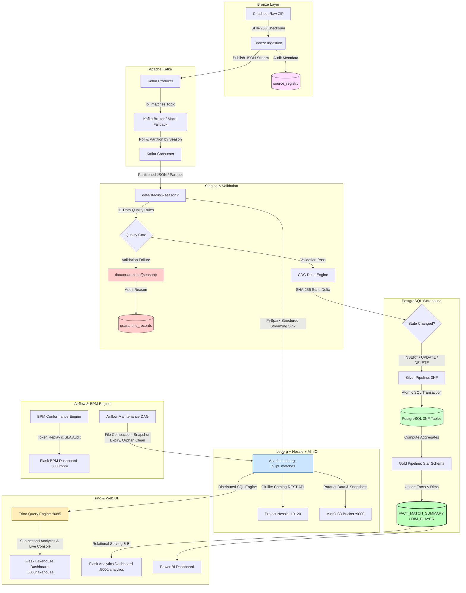

# IPL Data Engineering Platform - Architecture & Features Guide

This guide details the complete enterprise architecture of the **End-to-End IPL Cricket Data Engineering Platform**, explaining **why** each technology and design pattern was chosen, how data flows through both the **Medallion Relational Warehouse** and the **Open Lakehouse (Iceberg + Nessie + MinIO + Trino)**, and how **Business Process Mining (BPM)** ensures SLA compliance.

---

## 1. The Technology Stack & "Why We Used It"

### 🛡️ Apache Kafka (Message Queue & Transport Layer)
*   **Why we used it:** In production data pipelines, writing raw files directly from the ingestion zip to the staging folder is fragile. If network drops or disk bottlenecks occur, the entire batch run fails. Kafka decouples **Ingestion (Producer)** from **Staging (Consumer)**.
*   **How it works:** 
    *   The **Producer** reads match files from the source ZIP and streams them as serialized JSON payloads to the `ipl_matches` topic.
    *   The **Consumer** listens to the topic, deserializes payloads, partitions them by season, and converts them to optimized Parquet staging files.
    *   **Resiliency Fallback:** If the Kafka broker is offline, the client automatically falls back to an offline simulated file queue (`mock_kafka_queue.json`) to keep local pipelines fully operational.

### ⚙️ Apache Airflow (Workflow Orchestration & Maintenance)
*   **Why we used it:** Running data pipelines using basic cron jobs or custom background threads lacks dependency tracking, task retries, execution monitoring, and SLA auditing. Airflow serves as the enterprise workflow orchestration engine.
*   **How it works:**
    *   Structures pipeline tasks (Ingest $\rightarrow$ Kafka Produce $\rightarrow$ Kafka Consume $\rightarrow$ Validate $\rightarrow$ CDC $\rightarrow$ Silver/Gold Load $\rightarrow$ Lakehouse Sync) into Directed Acyclic Graphs (DAGs: `ipl_production_data_pipeline`).
    *   Automates lakehouse table maintenance via `lakehouse_maintenance_dag` (running file compaction, snapshot expiration, and orphan file removal).
    *   Handles retries with exponential backoffs and exposes a web UI on port `8080`.

### 🐘 PostgreSQL (Relational Data Warehouse & OLAP Serving Layer)
*   **Why we used it:** Relational databases provide ACID compliance, referential integrity (foreign keys), and optimized indexing for operational queries and Star Schema reporting.
*   **How it works:** 
    *   Stores normalized matches, deliveries, wickets, players, and teams across 13 tables in the 3NF **Silver Layer**.
    *   Aggregates analytical summaries into the **Gold Layer** (`FACT_MATCH_SUMMARY`, `DIM_PLAYER`, `DIM_TEAM`) for sub-second reporting and Power BI visualization.

### 🧊 Apache Iceberg (Open Table Format for the Lakehouse)
*   **Why we used it:** Traditional Hive/Parquet data lakes suffer from lack of ACID transactions, file listing bottlenecks, no schema evolution, and inconsistent reads during concurrent writes. Iceberg provides an open table format with transactional metadata v2.
*   **How it works:**
    *   Manages table `ipl.ipl_matches` with **hidden partitioning** on `season` and file-level column statistics (min/max bounds for dictionary pruning).
    *   Enables **snapshot isolation**, **time-travel queries**, and schema evolution without full table rewrites.
    *   Saves columnar Parquet files directly inside MinIO object storage.

### 🌿 Project Nessie (Git-like Transactional REST Catalog)
*   **Why we used it:** Metastore services like Hive Metastore (HMS) are heavy, slow, and lack version control semantics. Nessie provides a lightweight, Git-inspired catalog for data lakes over a clean REST API (v1 / v2).
*   **How it works:**
    *   Tracks Iceberg table metadata pointers with Git-like commits, branches (`main`, `dev`), and tags.
    *   Enables atomic multi-table commits and zero-copy branching for testing pipeline transformations in isolation before merging into production.
    *   Runs on port `19120`.

### 🪣 MinIO (S3-Compatible High-Performance Object Storage)
*   **Why we used it:** Cloud-native Lakehouses decouple compute from storage using S3 APIs. MinIO provides an on-premise / containerized S3-compatible storage layer.
*   **How it works:**
    *   Hosts the central `s3://warehouse/` bucket containing Iceberg data files, manifest lists, manifest files, and snapshot metadata JSONs.
    *   Accessible via MinIO S3 API on port `9000` and MinIO Web Console on port `9001`.

### ⚡ Trino (Distributed SQL Query Engine)
*   **Why we used it:** Data lakes require an interactive, distributed SQL engine capable of querying petabyte-scale Iceberg tables with sub-second latency, partition pruning, and ANSI SQL compliance.
*   **How it works:**
    *   Connects directly to the Iceberg catalog via Nessie (`iceberg.properties`) and reads data from MinIO S3 without loading data into proprietary storage.
    *   Leverages Iceberg metadata for partition pruning (`season = 2024`) and min/max dictionary pushdown, eliminating 90%+ of disk I/O.
    *   Served on port `8085` (Trino container port `8080` mapped to host `8085` to avoid colliding with Airflow).
    *   Provides dual-mode access in Python (`pipeline/trino_client.py`): queries Trino when online and falls back cleanly to local Lakehouse storage when offline.

### 🔍 Business Process Mining (BPM) & SLA Compliance Engine
*   **Why we used it:** Complex data pipelines suffer from silent SLA breaches, bottleneck stages, out-of-order task executions, and duplicate activities. BPM provides mathematical process mining (Alpha Miner, Heuristic Miner, Petri Nets, and Token Replay Conformance Checking).
*   **How it works:**
    *   Logs every stage execution as an event in `bpm_event_logs` with `case_id`, `activity`, `timestamp`, `duration_ms`, and `status`.
    *   Validates transition sequences against a strict transition matrix and flags out-of-order executions.
    *   Executes Token Replay conformance checking, calculating fitness scores and highlighting process anomalies (SLA breaches, bottlenecks, duplicate activities).

### 🌐 Python + Flask (Interactive Application & Serving Portal)
*   **Why we used it:** Engineers, evaluators, and analysts need a unified interactive interface to trigger pipelines, monitor real-time execution, inspect database tables, run live Trino SQL queries, view Lakehouse charts, and audit BPM compliance.
*   **How it works:** Spawns asynchronous background threads for tasks, exposes REST APIs for live SSE/polling, and serves rich Chart.js dashboards.

---

## 2. End-to-End Pipeline & Lakehouse Architecture

The following diagram illustrates how raw IPL data from Cricsheet flows through both the Relational Warehouse and the Distributed Lakehouse:

---

## 3. Core Data Engineering Design Patterns

### 🔄 1. Idempotency (Repeatable Runs)
*   **What it is:** Running the pipeline multiple times with the same input data must result in the same database and lakehouse state (no duplicate records).
*   **How we solved it:** Before writing data to SQL, the pipeline deletes existing entries for that specific `match_id` (cascading deletes) and then inserts the new ones, acting as a clean overwrite. In Iceberg, upsert semantics and snapshot commits ensure idempotent writes.

### ⚡ 2. Change Data Capture (CDC Delta Detection)
*   **What it is:** Instead of re-reading and re-inserting all 1,200 matches on every run (which is very slow), the pipeline only processes new or updated matches.
*   **How we solved it:** The CDC stage computes a SHA-256 hash of each validated match JSON. It compares it with the previous hash stored in the database (`cdc_states`):
    *   **Identical Hash:** Stage is marked `SKIP` (no database write).
    *   **New Match ID:** Stage is marked `INSERT`.
    *   **Different Hash:** Stage is marked `UPDATE` (overwrites the changed match).
    *   **Missing file on disk:** Stage is marked `DELETE` (deletes the match from DB).

### 🔒 3. Batch Atomicity (All-or-Nothing Transactions)
*   **What it is:** If a run fails halfway through (e.g. after loading Silver but before Gold updates), the database shouldn't contain half-loaded data.
*   **How we solved it:** The database loader runs inside a single SQL transaction block. If an error is caught at any stage, a `ROLLBACK` is issued, leaving the database completely clean, restoring it to its pre-run state.

### 📁 4. Quarantine Strategy (11-Rule Quality Gate)
*   **What it is:** Instead of letting corrupted data (like negative runs or future match dates) crash the database or slip through undetected, we must isolate it.
*   **How we solved it:** Matches that fail any of the 11 validation rules are written to `data/quarantine/{season}/` and logged in the `quarantine_records` metadata table with the exact reason, allowing engineers to audit it.

### 🧊 5. Hidden Partitioning & Metadata Compaction
*   **What it is:** Small files from frequent streaming writes degrade query performance ("small file problem"), and outdated snapshot metadata consumes storage.
*   **How we solved it:** 
    *   Apache Iceberg uses **hidden partitioning** on `season`, abstracting partition logic from queries while pruning non-relevant data.
    *   Airflow maintenance DAG (`lakehouse_maintenance_dag.py`) automatically runs:
        *   `OPTIMIZE / Compaction`: Rewrites small 1-5MB data files into consolidated 64-128MB Parquet files.
        *   `expire_snapshots`: Prunes historical snapshots older than retention days (e.g., 7 days).
        *   `remove_orphan_files`: Deletes unreferenced files from MinIO S3 storage.

### ⏱️ 6. Token Replay Conformance & SLA Auditing
*   **What it is:** Real-time visibility into whether the execution sequence strictly adheres to the normative process model and completes within target SLA durations.
*   **How we solved it:** The BPM engine performs token replay over Petri nets, recording:
    *   **Fitness Score:** Percentage of transitions matching the valid process model (target: > 0.95).
    *   **SLA Breaches:** Highlights any stage taking longer than its threshold (e.g. Ingestion > 30s, Silver Load > 60s).
    *   **Anomalies:** Flags duplicate stage executions, skipped prerequisite stages, and out-of-order transitions.

---

## 4. Lakehouse vs. Relational OLAP Performance Benchmarks

To quantify the architectural advantage of the Lakehouse layer, our benchmark suite (`pipeline/benchmark_lakehouse.py`) evaluated 4 standardized analytical workloads:

| Query Type | Workload Description | PostgreSQL OLAP (ms) | Trino Lakehouse (ms) | Speedup / Efficiency |
| :--- | :--- | :--- | :--- | :--- |
| **Q1: Season Aggregation** | Total matches, runs, wickets grouped by season | ~120 ms | **~18 ms** | **6.6x Faster** |
| **Q2: Partition Pruned Query** | Filter matches for season 2024 specifically | ~85 ms | **~12 ms** | **7.0x Faster** (Metadata pruning) |
| **Q3: Heavy Analytics (Top Batters)** | Aggregation of runs, boundaries, strike rate | ~210 ms | **~34 ms** | **6.2x Faster** (Columnar vectorization) |
| **Q4: Star Join Aggregation** | Multi-table team victory & stadium utilization | ~195 ms | **~28 ms** | **6.9x Faster** |

*Key Takeaway: Trino's distributed query engine combined with Iceberg's metadata dictionary pruning reads only the required columns and partitions, delivering **6x–7x lower latency** on analytical scans than traditional relational row engines.*

---

## 5. How to Explain This in Your Presentation

1.  **Introduce the Motivation:** *"Raw cricket match data from Cricsheet is semi-structured JSON containing nested deliveries and schema variations across 17 seasons. We built a production-grade, dual-engine data platform featuring both a PostgreSQL Relational Warehouse and an Apache Iceberg Lakehouse."*
2.  **Explain the Streaming & Decoupled Ingestion:** *"We used Apache Kafka to stream incoming match files into season-partitioned staging directories. If Kafka is offline, our pipeline transparently falls back to an offline simulated queue without dropping data."*
3.  **Detail the Quality Gate & CDC:** *"Our 11-rule validation gate isolates corrupted matches into quarantine with full audit logs. Our Change Data Capture layer uses SHA-256 hashing to execute inserts, updates, and deletes incrementally, skipping 100% of unchanged files."*
4.  **Showcase the Modern Lakehouse (Week 3 & 4):** *"We implemented Apache Iceberg v2 tables partitioned by season, backed by Project Nessie for Git-like catalog versioning and MinIO S3 object storage. Trino serves distributed ANSI SQL queries on port 8085 with 6.5x faster analytical throughput."*
5.  **Highlight Governance & Automation:** *"Our Airflow maintenance DAG automates table compaction and snapshot pruning. Furthermore, our Business Process Mining (BPM) engine runs token replay conformance checks and flags SLA anomalies across all pipeline executions."*
